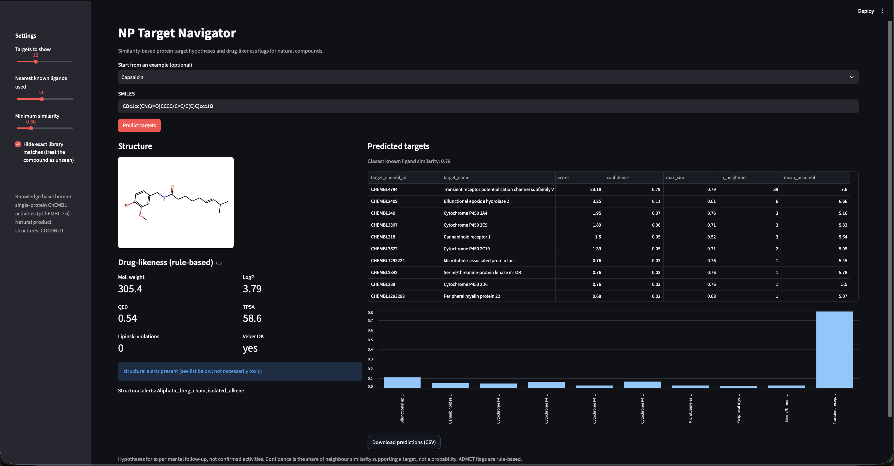

# NP Target Navigator

Similarity-based protein target hypotheses and rule-based drug-likeness flags for natural compounds.
Built solo for **EthnoHack 2026** (Natural Products & Drug Discovery track).



## The problem

Natural products are a rich source of drug leads, but for most of them it is unclear which human proteins they act on. Experimental target identification is slow and expensive, so researchers need a fast way to generate testable hypotheses first.

## What it does

Paste a SMILES string (or pick an example) and the app returns:

1. **Predicted protein targets**, ranked by similarity to known bioactive ligands.
2. **A domain warning** when the compound is far from anything in the knowledge base.
3. **Drug-likeness and structural-alert flags** (Lipinski, Veber, QED, PAINS, Brenk).
4. **A downloadable CSV** of the predictions.

Outputs are hypotheses for experimental follow-up, not confirmed activities.

## How it works

1. **Knowledge base.** Human single-protein activities from ChEMBL 37, filtered to `pChEMBL >= 5` (about IC50/Ki <= 10 uM), exact (`=`) measurements, and assay confidence score >= 8. After standardization this gives 1,442,568 compound-target pairs covering 934,347 unique compounds and 4,378 targets.
2. **Standardization.** RDKit cleanup, salt stripping and neutralization. Structures RDKit cannot parse are dropped.
3. **Fingerprints.** 2048-bit Morgan fingerprints (radius 2), compared with Tanimoto similarity.
4. **Prediction.** For a query compound, the 50 most similar known ligands (similarity >= 0.3) vote for their targets, weighted by similarity. The `confidence` column is the share of neighbour similarity supporting a target. It is a heuristic score, **not a probability**.
5. **Drug-likeness.** Rule-based checks computed with RDKit. These are structural flags, not ADMET predictions.

## Validation

300 random ChEMBL compounds were each hidden from the library, then their known targets were looked for among the top predictions. The baseline always predicts the 10 most frequent targets.

| Group (similarity to nearest other library compound) | Compounds | Top-1 | Top-5 | Top-10 | Baseline top-10 |
|---|---|---|---|---|---|
| Overall | 300 | 0.807 | 0.910 | 0.923 | 0.137 |
| >= 0.7 | 244 | 0.869 | 0.955 | 0.959 | 0.090 |
| 0.4 - 0.7 | 55 | 0.545 | 0.727 | 0.782 | 0.345 |
| < 0.4 | 1 | n/a | n/a | n/a | n/a |

"Top-N" means at least one known target of the compound appears among the first N predictions.

**How to read this.** Most test compounds (244 of 300) have a close analog in ChEMBL, which inflates the overall figure. The 0.4-0.7 row is the more realistic estimate for moderately novel structures. Only one test compound fell below 0.4, so performance on truly distant structures was not measured.

## Case studies

Each compound below was hidden from itself (`exclude_exact`), so targets come only from its structural analogs. Full output: [`docs/case_studies_output.txt`](docs/case_studies_output.txt).

| Compound | Top predictions | Consistent with known pharmacology? |
|---|---|---|
| Caffeine | Adenosine A2b and A2a receptors among the top 3 | Yes, a classic adenosine receptor antagonist |
| Capsaicin | TRPV1 first (confidence 0.79, 39 neighbours) | Yes, TRPV1 is its best-known target |
| Piperine | Monoamine oxidase B first | Consistent with reports of MAO inhibition |

Six compounds were run in total (also resveratrol, quercetin and curcumin); see the output file.

## Limitations

- **Retrospective checks.** The case-study compounds are well studied and have many ChEMBL analogs. The results show the method recovers known biology, not that it discovers new biology.
- **Coverage depends on ChEMBL.** Compounds with no close analogs get low-confidence predictions, and the app warns when the closest known ligand has similarity below 0.4.
- **Screening-derived hits.** Some predicted targets appear to come from large screening campaigns rather than validated pharmacology (for example, unexpected targets for caffeine). Check `n_neighbors` and `confidence` before trusting a hit.
- **No mechanism or direction.** Predictions do not say whether a compound is an agonist, antagonist or inhibitor.
- **Flags are rules.** Lipinski, Veber and structural alerts are screening heuristics, not measured ADME or toxicity.
- **Human single-protein targets only.** Protein complexes, non-human targets and phenotypic readouts are excluded.

## Repository layout

```
np-target-navigator/
├── app/streamlit_app.py     Streamlit interface
├── src/
│   ├── utils.py             structure standardization
│   ├── clean_chembl.py      ChEMBL SQLite -> activities_clean.parquet
│   ├── clean_np.py          COCONUT CSV -> np_clean.parquet
│   ├── fingerprints.py      builds ligand_fps.pkl
│   ├── predict.py           predict_targets(smiles)
│   ├── admet.py             get_admet_flags(smiles)
│   ├── validate.py          hold-one-out validation
│   └── case_studies.py      six example compounds
├── docs/                    case-study output
├── data/                    local data (not committed)
├── THIRD_PARTY.md           datasets and libraries with licences
└── requirements.txt
```

## Setup

Developed with Python 3.14 on macOS. Tested only on that setup.

```bash
git clone https://github.com/biswajit108sahu-netizen/np-target-navigator.git
cd np-target-navigator
python3 -m venv .venv
source .venv/bin/activate
pip install -r requirements.txt
```

### Data (not included in the repo)

The processed files are too large for GitHub, so regenerate them:

1. Download the ChEMBL 37 SQLite release (`chembl_37_sqlite.tar.gz`, about 5.5 GB; about 30 GB once extracted) from the ChEMBL FTP site, extract it, and place the database at `data/raw/chembl.db`.
2. Run the pipeline from the project root:

```bash
python src/clean_chembl.py     # about 25 minutes; writes data/processed/activities_clean.parquet
python src/fingerprints.py     # about 4 minutes; writes data/processed/ligand_fps.pkl
```

The raw database is only needed for the first step and can be deleted afterwards.

3. Optional: download the COCONUT CSV from coconut.naturalproducts.net, save it as `data/raw/coconut.csv`, and run `python src/clean_np.py`. This produces 735,519 cleaned natural product structures that were used to find example compounds. They are not part of the prediction library.

### Run

```bash
streamlit run app/streamlit_app.py     # opens http://localhost:8501
python src/predict.py "<SMILES>"       # command-line prediction
python src/admet.py "<SMILES>"         # drug-likeness flags
python src/validate.py                 # reproduce the validation table
python src/case_studies.py             # reproduce the case studies
```

The app runs locally and calls no external service or AI model.

## Data sources and licences

Full details are in [`THIRD_PARTY.md`](THIRD_PARTY.md).

| Resource | Used for | Licence |
|---|---|---|
| ChEMBL 37 | Compound-target bioactivity | CC BY-SA 3.0 |
| COCONUT 2.0 (Nov 2026 release) | Natural product structures | CC0 |
| RDKit | Cheminformatics | BSD-3-Clause |

Please cite the underlying resources if you build on this work, including Chandrasekhar et al., *COCONUT 2.0*, Nucleic Acids Research (2024), gkae1063.

## Built during the hackathon

All code in this repository was written during EthnoHack 2026 (2-8 November 2026). The datasets and open-source libraries above are pre-existing. Parts of the code were written with assistance from an AI assistant (Claude, by Anthropic).

## Author

Biswajit Sahu ([@biswajit108sahu-netizen](https://github.com/biswajit108sahu-netizen)), solo entry.

See [`LICENSE`](LICENSE) for the licence of this code.

| Group (similarity to nearest other library compound) | Compounds | Top-1 (95% CI) | Top-5 (95% CI) | Top-10 (95% CI) | Baseline top-10 (95% CI) |
|---|---|---|---|---|---|
| Overall | 300 | 0.81 (0.76-0.85) | 0.91 (0.87-0.94) | 0.92 (0.89-0.95) | 0.14 (0.10-0.18) |
| 0.4 - 0.7 | 55 | 0.55 (0.42-0.67) | 0.73 (0.60-0.83) | 0.78 (0.66-0.87) | 0.35 (0.23-0.48) |
| >= 0.7 | 244 | 0.87 (0.82-0.91) | 0.96 (0.92-0.97) | 0.96 (0.93-0.98) | 0.09 (0.06-0.13) |
| < 0.4 | 1 | n/a | n/a | n/a | n/a |

Intervals are 95% Wilson score intervals (`src/validation_ci.py`, output in `docs/validation_ci.txt`).

## How far are natural products from the training data?

In a random sample of 400 COCONUT compounds (`src/novelty_scan.py`, output in `docs/coconut_novelty_scan.csv`), the median similarity to the nearest ChEMBL ligand was 0.50. About 10% were below 0.3, 26% below 0.4 and 80% below 0.7. By contrast, 81% of the ChEMBL validation compounds had a neighbour at 0.7 or above. The overall validation figure therefore overstates expected performance on natural products, and the 0.4-0.7 row is the more realistic guide. About a quarter of natural products fall below 0.4, where validation data is almost absent and the app shows a low-confidence warning. Percentages carry roughly +/-4 points of sampling error, and they assume the similarity-accuracy relationship holds for natural products, which was not tested.

## Why similarity voting

Bioactivity data is sparse and uneven across targets, which makes it hard to train reliable per-target models. Nearest-neighbour voting is a strong, standard baseline for this setting. It needs no training, and every prediction can be traced to named neighbouring compounds with measured potencies, which supports the uncertainty reporting in the app.

## Potential impact

The tool helps researchers prioritise which natural compounds are worth experimental follow-up, using only a structure as input. It supports target-hypothesis generation in natural-product and ethnopharmacology research, and everything is open and reproducible.

## Next steps

- Harder validation with scaffold-based splits, and a larger sample of low-similarity compounds.
- Add natural-product-specific bioactivity sources to widen coverage.
- Check top hits with docking or experimental assays.
- Calibrate the confidence score so it can be read as a probability.
- Extend beyond human single-protein targets.